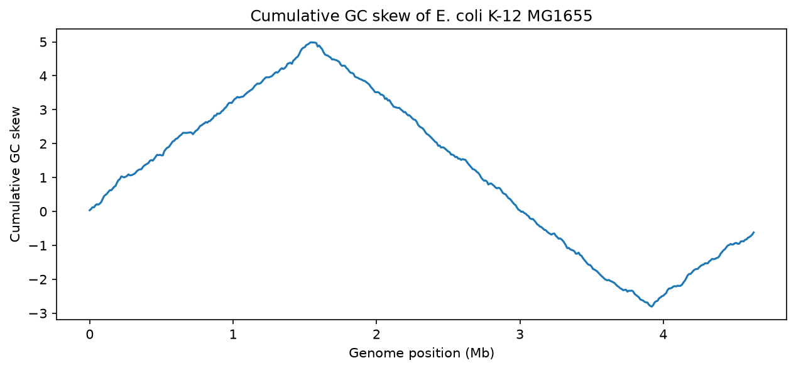

# E. coli GC skew
# GC skew analysis of the E. coli genome

Finding the origin of DNA replication in the *E. coli* K-12 MG1655 genome
using cumulative GC skew, with Python and Biopython.

## Background
In bacteria, replication starts at one origin and proceeds in both
directions. The two DNA strands are copied differently, which leaves a
small bias in the ratio of G to C bases. Plotting the cumulative GC skew
along the genome gives a curve that changes direction at the origin
(minimum) and the terminus (maximum).

## What this project does
1. Downloads the genome (NCBI accession NC_000913.3) with Biopython
2. Calculates GC content and GC skew in 10,000 bp windows
3. Plots the cumulative GC skew
4. Estimates the positions of the origin and terminus

## Result


The minimum of the curve is at about [X.XX] Mb and the maximum at about
[X.XX] Mb. [One sentence comparing this with the annotated oriC position
on NCBI: how close was it, and why might it differ?]

## How to run it
```
git clone https://github.com/tojotkaa/ecoli-gc-skew.git
cd ecoli-gc-skew
python -m venv venv
venv\Scripts\activate
pip install biopython pandas matplotlib numpy jupyter
mkdir data
jupyter notebook
```
Open `notebooks/gc_skew.ipynb` and run all cells. The genome is downloaded
automatically.

## Tools
Python, Biopython, NumPy, Matplotlib, Jupyter

## Next steps
- [One or two things you'd try next, e.g. other window sizes or another bacterium]